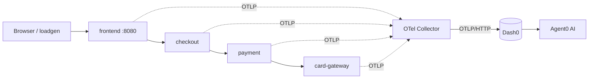

# 🛒 OnCall Outfitters: AI Observability Demo with Dash0

A small, **real** microservices shop that sends **traces, metrics and logs** to [Dash0](https://www.dash0.com) using **OpenTelemetry**, with a built-in **chaos switch** so you can break it on purpose and watch **Agent0** (Dash0's AI) find the root cause.

> ⚠️ Not sponsored by or affiliated with Dash0. Dash0 is a paid platform with a free trial; Agent0 usage may consume credits on your plan.

---

## 🏗️ Architecture



| Service | Port | Role |
|---|---|---|
| `frontend` | 8080 (exposed) | Shop UI, Chaos Control page, API |
| `checkout` | 8082 | Creates orders, emits `shop.orders` metric |
| `payment` | 8083 | Charges cards, **2s timeout** to the bank |
| `card-gateway` | 8084 | Fake "bank", where latency gets injected |
| `loadgen` | – | Simulates customers (a few orders per second) |
| `otel-collector` | 4317/4318 (internal) | Receives OTLP, exports to Dash0 |

All Python services use **OpenTelemetry zero-code auto-instrumentation** (`opentelemetry-instrument`), so there's no tracing boilerplate in the app code.

---

## ✅ Prerequisites

- Linux/macOS with **Docker** + **Docker Compose v2** (`docker compose version`)
- ~1.5 GB free RAM
- A **Dash0 account** (free trial works)

---

## 🚀 Quick start

```bash
git clone https://github.com/<your-username>/oncall-outfitters.git
cd dash0-ai-observability-demo
cp .env.example .env
nano .env                      # add your Dash0 endpoint + token
docker compose up -d --build
```

Open:
- 🛒 Shop → http://localhost:8080
- 🧪 Chaos Control → http://localhost:8080/admin

After 2–3 minutes, your 4 services appear in **Dash0 → Services**.

---

## 🔐 Environment variables

### `.env` (your secrets, never commit this file)

| Variable | Required | Where to find it | Used by |
|---|---|---|---|
| `DASH0_ENDPOINT` | ✅ | Dash0 → Organization Settings → **Endpoints → OTLP via HTTP**. Must match **your org's region** (e.g. `us-west-2`, `eu-west-1`) | `otel-collector` |
| `DASH0_AUTH_TOKEN` | ✅ | Dash0 → Organization Settings → **Auth Tokens** → create one with **Ingest** permission. Starts with `auth_`, no `Bearer` prefix | `otel-collector` |
| `DASH0_DATASET` | ✅ | Dataset name, `default` works | `otel-collector` |

### Service settings (already set in `docker-compose.yml` / code defaults)

| Variable | Default | Used by | Purpose |
|---|---|---|---|
| `OTEL_SERVICE_NAME` | per service | all apps | Service name shown in Dash0 |
| `OTEL_EXPORTER_OTLP_ENDPOINT` | `http://otel-collector:4318` | all apps | Where apps send telemetry |
| `OTEL_EXPORTER_OTLP_PROTOCOL` | `http/protobuf` | all apps | OTLP protocol |
| `OTEL_TRACES_EXPORTER` / `OTEL_METRICS_EXPORTER` / `OTEL_LOGS_EXPORTER` | `otlp` | all apps | Enable all 3 signals |
| `OTEL_PYTHON_LOGGING_AUTO_INSTRUMENTATION_ENABLED` | `true` | all apps | Ship Python logs via OTLP |
| `OTEL_METRIC_EXPORT_INTERVAL` | `10000` | all apps | Metrics every 10s |
| `OTEL_RESOURCE_ATTRIBUTES` | `service.namespace=oncall-outfitters,...` | all apps | Groups services in Dash0 |
| `CHECKOUT_URL` | `http://checkout:8082` | frontend | Checkout address |
| `GATEWAY_URL` | `http://card-gateway:8084` | frontend, payment | Bank address |
| `PAYMENT_URL` | `http://payment:8083` | checkout | Payment address |
| `GATEWAY_TIMEOUT_S` | `2.0` | payment | How long payment waits for the bank |
| `FRONTEND_URL` | `http://frontend:8080` | loadgen | Target for fake traffic |

> After changing `.env`, run `docker compose up -d --force-recreate otel-collector`. A plain `restart` does **not** reload `.env`.

---

## 💥 Break it (chaos modes)

Use the UI at http://localhost:8080/admin, or the terminal:

| Mode | Gateway delay | Result |
|---|---|---|
| ✅ Healthy | 0 ms | All orders succeed |
| 🐢 Degraded bank | 1800 ms | ~40% of payments time out |
| 🔥 Bank outage | 3000 ms | All payments time out |

```bash
# Outage
curl -s -X POST http://localhost:8080/api/chaos -H "Content-Type: application/json" -d '{"latency_ms":3000}'
# Degraded
curl -s -X POST http://localhost:8080/api/chaos -H "Content-Type: application/json" -d '{"latency_ms":1800}'
# Healthy
curl -s -X POST http://localhost:8080/api/chaos -H "Content-Type: application/json" -d '{"latency_ms":0}'
```

---

## 🔎 What to look at in Dash0

| Where | What you'll see during chaos |
|---|---|
| **Services** (catalog) | `checkout` / `payment` / `frontend` error % rising; `card-gateway` 0% errors but slow |
| **Services → Map** | Red dots flowing frontend → checkout → payment |
| **Tracing** | Red `POST /authorize` client spans timing out at ~2s |
| **Logging** | `card-gateway did not respond within 2.0s` |
| **Metrics** | `shop.orders` split by `status` (confirmed / failed) |
| **Agent0** | AI investigation of the root cause |

### 🤖 Agent0 prompts to try

Wait about 10 minutes after breaking it, then ask:

1. `Why are checkouts failing right now?`
2. `What is the root cause of the payment service errors? Show me the evidence from traces and logs.`
3. `Create an alert for the payment service error rate.`

---

## 🛠️ Troubleshooting

| Symptom | Fix |
|---|---|
| Collector logs `401 invalid authentication token` | Endpoint region doesn't match your org, or wrong token. Check Dash0 → Endpoints |
| `authentication token is blocked` | Too many failed attempts. Create a new token, wait 10–15 min |
| `loadgen` shows `buy 502` | Chaos mode is on. Set **Healthy** on `/admin` |
| No data in Dash0 | Check the time range + dataset selector, then `docker compose logs otel-collector --tail 30` |
| Test your token/endpoint | See the `curl` test below |

```bash
set -a; source .env; set +a
curl -s -o /dev/null -w "%{http_code}\n" -X POST "$DASH0_ENDPOINT/v1/logs" \
  -H "Authorization: Bearer $DASH0_AUTH_TOKEN" -H "Dash0-Dataset: $DASH0_DATASET" \
  -H "Content-Type: application/json" -d '{"resourceLogs":[]}'
# 200 = OK, 401 = wrong token or region
```

---

## 📁 Project structure

```
.
├── docker-compose.yml       # all services + collector
├── otel-collector.yaml      # OTLP in → Dash0 out
├── Dockerfile               # one Python image, auto-instrumented
├── requirements.txt
├── .env.example             # copy to .env
└── services/
    ├── common.py            # logging setup
    ├── frontend.py          # shop UI + chaos control
    ├── checkout.py          # orders + shop.orders metric
    ├── payment.py           # 2s timeout to the bank
    ├── card_gateway.py      # fake bank + latency injection
    └── loadgen.py           # fake customers
```

---

## 🧹 Cleanup

```bash
docker compose down
```

Also revoke your Dash0 token if you no longer need it.

---

## 📄 License

